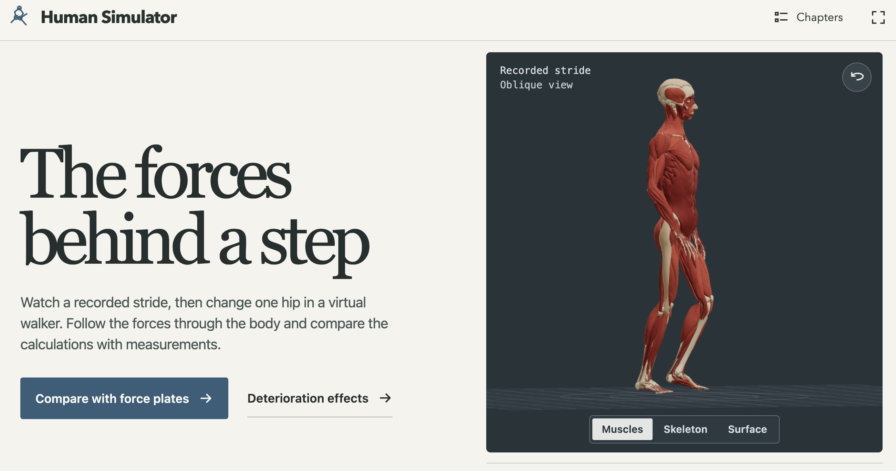
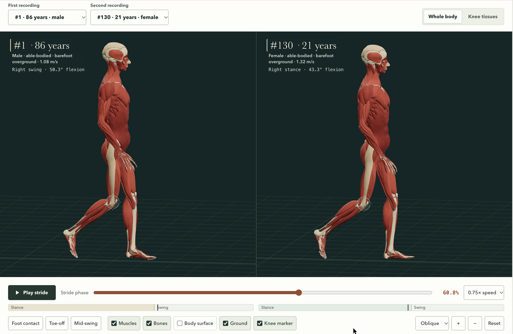
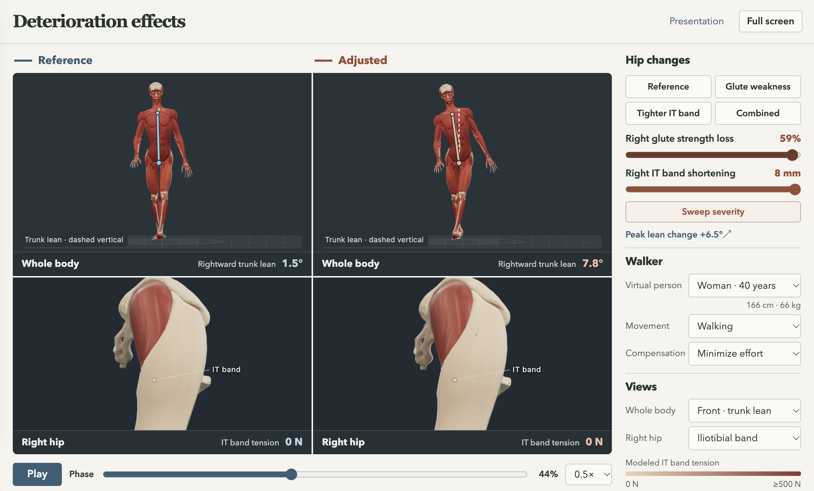
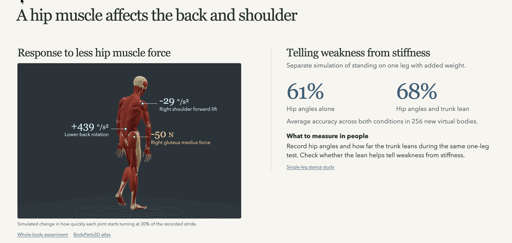
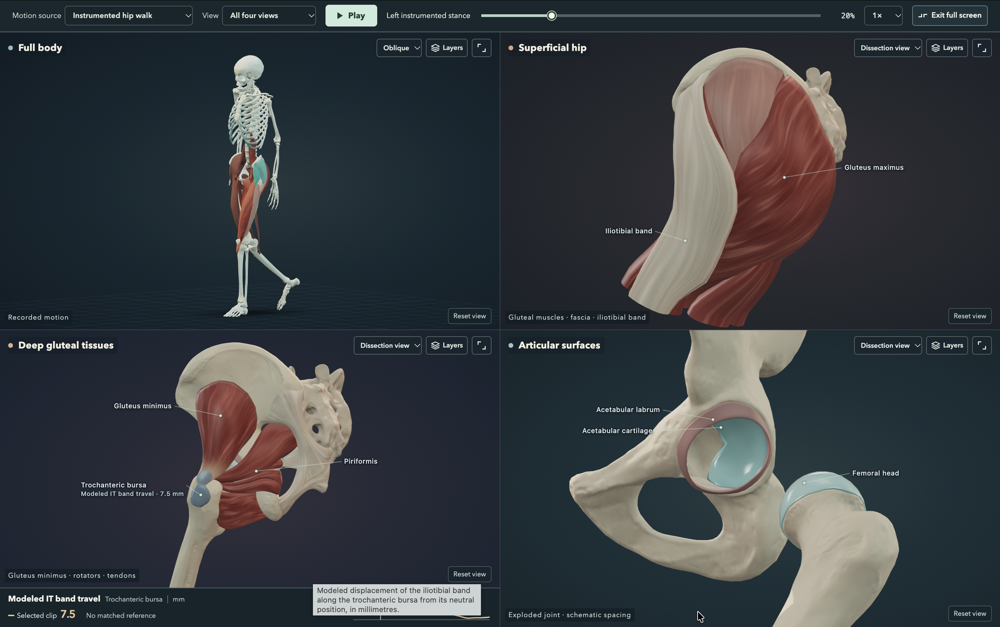
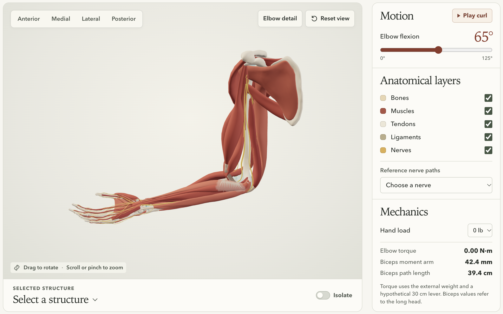
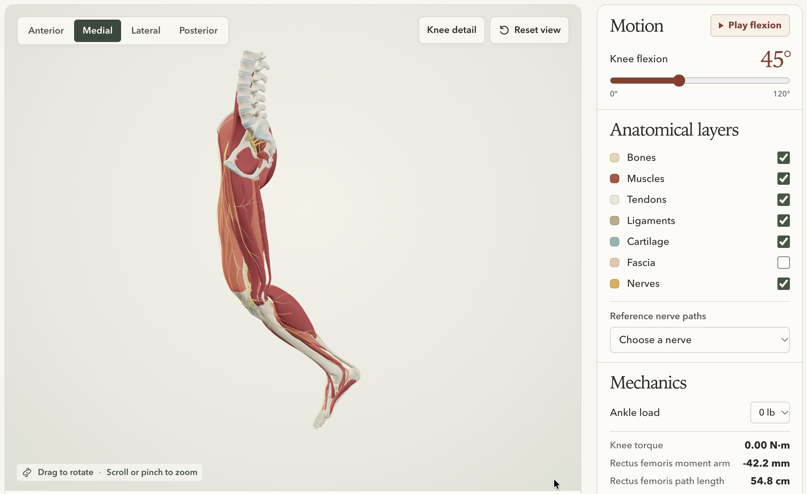

# Human Simulator

**A full-body biomechanics simulator for studying how people move and how that movement loads muscles, tendons, and joints.**

Start with a recorded stride, follow the forces from the ground through the body, and zoom in to the tissues that carry them. Change a property of the virtual body and compare what happens at the joint and across the whole movement.

[Run the anatomy viewer locally](#run-locally)



## Follow the forces through the whole body

Compare motion-capture recordings side by side and step through foot contact, toe-off, and swing. A 24-body OpenSim model accounts for the arms, trunk, and both legs when reconstructing the center of mass and estimating the force on the ground.



In one recorded forefoot-strike stride, the whole-body estimate reduced RMS vertical force error against force plates from **43.4 N to 30.9 N** compared with a pelvis-height estimate. [Source model and recordings](https://github.com/gilserrancoli/ReducePoly_forMSK/tree/00b6f94ee8bd2f60ae5b6f07a114f1aade089cb8)

## Change one hip and see how the walker responds

Reduce glute strength or shorten the iliotibial (IT) band, then compare the same virtual walker before and after the change. Synchronize the reference and adjusted views to see how trunk lean, hip flexion, and tissue tension evolve through the stride. [Reference walking model](https://github.com/antoinefalisse/3dpredictsim/tree/5fa3929fa9ba29d5c057c16b18671a017d8f15c1)



## A change at the hip can reach the back and shoulder

In a simulated pose 30% into a recorded stride, reducing right gluteus medius force by **50 N** changed the initial angular acceleration of lower-back rotation by **+439°/s²** and right shoulder flexion by **−29°/s²**.



In a separate simulated single-leg stance with added weight, including trunk lean alongside hip angles raised balanced accuracy for distinguishing hip weakness from stiffness from **61% to 68%** across 256 held-out virtual bodies. The result suggests measuring both during the same test in people.

## Anatomical precision, from joint to tissue

Follow one instant of gait across four synchronized views of the body, outer hip, deep gluteal muscles, and joint surfaces. Inspect where tissues attach, how their paths wrap around joints, and how those paths change as the skeleton moves.



Across 512 sampled joint configurations, the paired gait model’s IT band path length had a **0.013 mm mean absolute error** relative to direct OpenSim geometry. Force plates and instrumented implants provide experimental references for external forces and internal joint loads. [Grand Challenge experiment](https://doi.org/10.1002/jor.22023)

| [Arm anatomy](upper-limb/README.md) | [Leg anatomy](lower-limb/README.md) |
| --- | --- |
|  |  |

## Accelerate tissue physics and calibration on GPUs

The tissue simulation design uses fine tetrahedral meshes near attachments and contact surfaces, where strain and pressure change quickly. GPU kernels compute element forces and detect contacts in parallel, advancing the skeleton and deformable tissues together. Parallel calibration makes it possible to compare large sets of muscle and tissue parameters against measured forces.

The knee calibration benchmark scored **1,048,576 candidates across 91 measured stance frames** in a single warm batch.

| Hardware | Time per batch |
| --- | ---: |
| NVIDIA H100 GPU | **4.73 ms** |
| Apple M4 GPU | 58.11 ms |
| Apple M4 CPU (8 threads) | 116.35 ms |

The GPU timings include candidate upload and score readback.

## Applications

- **Rehabilitation research.** Compare how changes in muscle strength, tissue stiffness, or gait strategy redistribute loads. Identify which movements and forces to measure in follow-up studies.
- **Sports biomechanics.** Compare foot strike, cadence, and movement technique by their effects on joint loading and muscle demand.
- **Implant and assistive-device design.** Compare how changes in joint geometry or external support redistribute forces through a movement.
- **Anatomy education.** Step through a movement, isolate a tissue layer, and see how muscle and tendon paths shape joint mechanics.

## Run locally

```sh
cd upper-limb
npm ci
npm run dev -- --port 5178
```

[Arm viewer](http://127.0.0.1:5178/?region=arm) · [Leg viewer](http://127.0.0.1:5178/?region=legs)

Run `npm run build` from `upper-limb` to build the web app and the offline `dist/upper-limb-viewer.html` and `dist/lower-limb-viewer.html`. [Animated arm GLB](upper-limb/assets/upper-limb.glb) · [Animated leg GLB](lower-limb/assets/lower-limb.glb) · [SimTK datasets and modeling resources](docs/simtk-review.md)

## Anatomy credits

The walking atlas uses BodyParts3D © DBCLS under CC BY-SA 2.1 Japan. The limb and outer hip anatomy adapt Open3DModel under CC BY-SA 4.0. [BodyParts3D source](https://dbarchive.biosciencedbc.jp/en/bodyparts3d/download.html) · [BodyParts3D license](https://creativecommons.org/licenses/by-sa/2.1/jp/deed.en) · [Open3DModel license](https://creativecommons.org/licenses/by-sa/4.0/)
