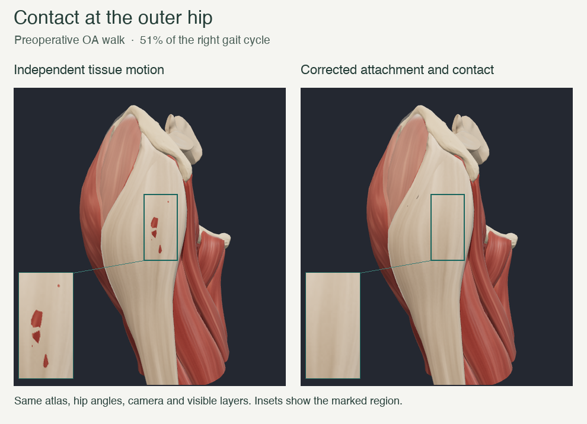

# Contact at the outer hip

At 51% of the preoperative OA walking cycle, several red patches appeared inside the pale iliotibial band. A depth pass identified the red surface as tensor fasciae latae (TFL). At the centres of the three largest patches, ray–triangle intersections placed the muscle 0.21, 0.12 and 0.24 mm in front of the band in the inspection camera. Neighbouring rays reached the band first. Both structures had been animated from the same hip angles using separate attachment fields.



## Which surfaces should stay together?

Cadaver dissections describe superficial and deep portions of the iliotibial tract around TFL. A useful contact model therefore lets the outer cover move around the muscle while preserving the tract’s course on the other side. Gluteus maximus also connects to the fascia lata. Dissecting a single atlas does not establish an individual participant’s fascial attachment footprint. [Iliotibial tract dissection](https://pubmed.ncbi.nlm.nih.gov/15378277/) · [Gluteus maximus and fascia lata](https://pubmed.ncbi.nlm.nih.gov/24139012/)

The earlier attachment model treated the lowest part of TFL as if the muscle had been cut at the lower boundary of the atlas. The muscle actually ends about 110 mm above that boundary. Its 21 distal anchor vertices lie 0.04–1.51 mm from the iliotibial tract. The old model made those vertices follow 100% of the femoral rotation, while the adjacent tract followed approximately 53–59%. The resulting mismatch varied through the stride. [Registered atlas and coordinates](../upper-limb/hip-study/assets/hip-atlas-SOURCES.md)

The distal anchors now inherit the motion of the nearest point on their tract triangle. The proximal anchors stay on the pelvis. Between the anchors, a smooth field on the connected muscle mesh combines distance along the muscle with the motion of nearby fascia. The fascial contribution tapers between 1 and 3 mm from the sheet. These distances and the smoothing strength are model parameters. [Attachment calculation](tools/prepare_hip_deformation.py)

## Contact during movement

The model uses the segmented surfaces in three dimensions. It works in a coordinate frame halfway between the pelvis and femur. For a pair of triangles on opposing surfaces, their projected overlap is a polygon. Within that polygon, the separation varies linearly. Testing its corners captures the worst inward crossing, including a crossing that falls between mesh vertices. A spatial grid limits these comparisons to nearby triangles.

The band can move outward to restore a nominal 0.25 mm gap along the projection direction. A limit of 0.28 mm of added displacement per millimetre of material distance spreads the correction along the sheet. Nearby vertices across thin walls are coupled. The model identifies the outside of the TFL cover from the neutral atlas and preserves the band's fixed endpoints and eight tracked points on its deep TFL interface. These constraints allow the band to wrap around the muscle. Solving at each requested pose gives the same geometry when playing forward, scrubbing backward, or jumping to a new clip. The native analysis and browser use the same solver source. [Numerical solver](contact/contact.c) · [Reference interfaces and build](tools/prepare_hip_contact.py)

This is a quasi-static surface-contact model. Motion comes from hip angles and inferred attachment fields. The reference anatomy supplies surface shape and layer order. The model has no measurements of patient-specific muscle deformation, stiffness, fascial tension, contact pressure or inflammation. Whole-body motion uses a separately registered model. The contact calculation described here applies to the magnified hip atlas.

## What the checks measure

The image check renders a structure ID for every visible opaque surface pixel, then renders the band by itself from the same camera. Within the band silhouette, a fully enclosed group of two or more muscle pixels flags a potential breakthrough. Multiple camera angles distinguish this from a muscle that extends past the band’s edge. [Browser visibility audit](tools/audit_contact_visibility.mjs)

The independent geometric audit intersects posed muscle, bone and bursa triangles with band triangles and measures the parts of the intersection lines on the exposed lateral surface. It can detect an edge piercing a triangle face even when vertex-only tests miss it. Intersection-line length describes the extent of a crossing. The depth differences above describe distance along a particular viewing ray. [Triangle audit](tools/audit_hip_contact.py)

## Results

| At the marked frame | Original motion | Corrected TFL attachment | Corrected attachment and contact |
| --- | ---: | ---: | ---: |
| Pixels in the three largest original patches where TFL was in front | 362 | 3 | 0 |
| Band depth ahead of TFL at the first patch centre | −0.207 mm | 0.613 mm | 0.613 mm |
| At the second patch centre | −0.118 mm | 0.753 mm | 0.837 mm |
| At the third patch centre | −0.239 mm | 0.080 mm | 0.339 mm |
| Total length of exposed TFL crossing lines in 3D | 96.63 mm | 2.99 mm | 0 mm |

Across all enclosed muscle patches at this camera angle, the original frame had 372 affected pixels and the corrected frame had zero. All 362 rays in the three largest original patches cleared the muscle at assumed contact gaps of 0.125, 0.25 and 0.50 mm. At the default gap, half the band's vertices required zero correction in this pose, 90% moved at most 0.60 mm and the largest correction was 2.56 mm. [Fixed-ray comparison](data/contact-ablation.json) · [Solver measurements](data/hip-contact-validation.json)

Across the 707 sampled poses in the seven clips, independent triangle checks found zero outer-band crossings by TFL after correction. Correcting the attachment alone left crossings on the designated TFL cover in 55 of the 101 OA poses. At least 99.1% of the originally enclosed TFL sample area remained enclosed at every sampled pose. The two-camera image test found enclosed muscle patches in 660 original frames from the front-oblique view and 435 from the rear-oblique view. Neither view showed such a patch in any corrected frame. At 7,007 sampled and interpolated poses the solver met its enforced directional clearance constraints to within 0.001 mm. [Independent geometry audit](data/contact-audit.json) · [Two-camera visibility results](data/hip-contact-visibility.json) · [Dense pose sweep](data/hip-contact-validation.json)

**Remaining intersections.** Several tissue surfaces already intersect at attachments in the reference dissection. Near one such interface with vastus lateralis, a different thigh muscle, new pairs of triangles crossed in 232 of the 707 sampled poses. At the worst pose, their exposed intersection lines totalled 0.076 mm and lay 14.8–15.0 mm above the atlas's lower cut plane. Two stress tests outside the seven replays also left clearance deficits, including 3.61 mm at isolated 75° hip flexion. Tissue thickness and strain need independent validation. In the replay sweep, an individual material edge changed length by up to about 21% due to contact correction. [Residual crossings](data/contact-audit.json) · [Shape and extreme-pose checks](data/hip-contact-validation.json)

## Reproduce

In the Motion lab, select **Preoperative hip OA**, move the slider to **51%** and inspect **Superficial hip**. The figure uses an oblique camera 26° anterior of lateral and elevated 10°. The numerical audits use the bundled atlas and motion files.

Run from the repository root with Python, NumPy, SciPy, trimesh, embreex and clang installed. Rebuilding the browser solver also requires LLVM with the WebAssembly target and `wasm-ld`. The checked-in assets are sufficient to launch the viewer.

```sh
python3 hip-study/tools/prepare_hip_deformation.py
python3 hip-study/tools/prepare_hip_contact.py
python3 hip-study/tools/prepare_bursa_mechanics.py
python3 hip-study/tools/audit_contact_ablation.py --output /tmp/hip-ablation.json
python3 hip-study/tools/audit_hip_contact.py --all-clips --corrected --output /tmp/hip-crossings.json
python3 hip-study/contact/validate_projection.py --output /tmp/hip-projection.json
node hip-study/tools/audit_bursa_chart.mjs
```

To repeat the image test, start the Vite dev server and run the following with Playwright and Chromium installed. The audit supports `PLAYWRIGHT_MODULE` and `CHROMIUM_EXECUTABLE` overrides.

```sh
HIP_STUDY_URL=http://127.0.0.1:5179 node hip-study/tools/audit_contact_visibility.mjs > /tmp/hip-visibility.json
```
